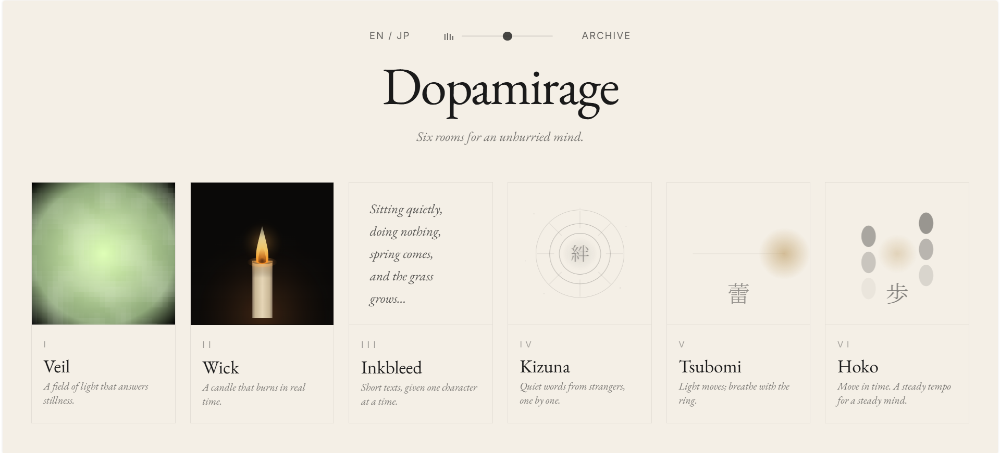

<div align="center">

# Dopamirage

*Six quiet rooms for a brain on too many feeds.*

<br>

<!-- screenshot of the portal goes here -->


<br><br>

[](#)
[](#)
[](#)
[](LICENSE)

[**Open the rooms →**](https://dopamirage.vercel.app)

</div>

<br>

---

## What it is

A non-stimulant digital space. Six rooms in a single web page, each doing exactly one thing. Slowly.

No accounts. No notifications. No build step. No backend. Drop the HTML file on a static host and you have the whole thing.

Available in **English, 日本語, Español, Português and 简体中文**, with a built-in guide (open **guide / 使い方** at the top, or visit `#guide`) that shows each room in a short looping clip.

The name is **dopamine** + **mirage** — the small illusion of reward that feeds produce, and what dissolves when attention returns.

<br>

---

## The rooms

| | | |
|---|---|---|
| **Veil**     · 一  | A field of light that answers stillness.                | Ganzfeld field. The longer you don't move, the more you see. |
| **Wick**     · 二  | A candle that burns in real time.                       | Long-form timer. Survives tab close, page reload, overnight. |
| **Inkbleed** · 三  | Short texts, given one character at a time.            | Slow reading with character-paced reveal. |
| **Kizuna**   · 四  | Quiet words from those who came before, one by one.    | Breath-paced stream of public-domain passages + a one-line note you can leave (kept on your device). |
| **Tsubomi**  · 五  | Light moves; breathe with the ring.                    | Box breathing paired with side-to-side light. |
| **Hoko**     · 六  | Move in time. A steady tempo for a steady mind.        | Left/right metronome for walking, jogging or jumping in place. |

<br>

---

## Small things around the rooms

- **Guide (`#guide`)** — a booklet-style page explaining every room, with a short demo clip per room in your language.
- **Micro-season line** — the portal names the current one of the 72 micro-seasons (七十二候) of the old Japanese calendar.
- **Wick intention** — an optional line for what the flame is for; it glows under the timer and stays with the mark. Candles and focus · rest bells keep time even while you're in another room.
- **Screen stays awake** while a candle burns or Hoko is counting steps (where the browser supports it).
- **Back button** returns to the entrance instead of leaving the site. Rooms can be deep-linked (`#wick`, `#tsubomi`, …).
- **Keyboard** — `1`–`6` rooms · `G` guide · `A` archive · `M` mute · `L` language · `Esc` back.
- **Archive backup** — export your marks to a file, import them on another device, or forget everything.
- Respects `prefers-reduced-motion`.

<br>

---

## Why

The screens we carry are designed to predict the next moment you'll want to look. The prediction is usually wrong; it just needs to be close enough that your hand moves anyway.

This is a small, undefended space where that loop doesn't run.

Each room borrows one simple, well-known idea:

- **Veil** — a Ganzfeld: an even field of light with nothing to scan.
- **Wick** — time you can see. A candle is a clock that costs nothing to glance at.
- **Inkbleed** — reading that can't be skimmed, so attention rests on meaning.
- **Kizuna** — unhurried words at about the pace of a slow breath, instead of a feed.
- **Tsubomi** — box breathing (four even counts) with a light that travels side to side.
- **Hoko** — a steady, conversational walking pace with a left/right tick.

None of these are miracles, and none of them are treatment. Dopamirage is **not a medical device** and does not diagnose, treat or prevent any condition. They are just things people often find calming when they have time for them.

<br>

---

## Run it

```bash
git clone https://github.com/<your-org>/dopamirage.git
cd dopamirage
# any static server will do
python3 -m http.server 8000
# → http://localhost:8000
```

Or just open `index.html` in a browser. It's one file.

To deploy: copy `index.html` together with `fonts/` (and optionally `docs/guide/` for the guide's demo clips) anywhere — GitHub Pages, Netlify, an SD card. Nothing is loaded from third-party CDNs: the Tailwind utilities are compiled and inlined, and the fonts are self-hosted. If you add or change Tailwind classes, regenerate the inlined CSS with `node scripts/build-css.mjs`.

<br>

---

## Stack

- **Vanilla JavaScript.** No framework, no transpiler, no package.json that matters.
- **HTML Canvas 2D** for everything visual (Veil's field, Wick's flame, Kizuna's blooms, Tsubomi's pulse, Hoko's landscape).
- **Web Audio API** for everything audible — no audio files are bundled. Bells, woodblocks, candle crackle and breath pads are all synthesized at runtime.
- **localStorage** for session state. There is no server. There has never been a server.
- **Tailwind (compiled & inlined)** and **self-hosted fonts** (SIL OFL) — no external CDNs. Roughly 580 KB of single-file HTML.

<br>

---

## Project structure

```
dopamirage/
├── index.html          # the whole application
├── README.md
├── LICENSE             # MIT (code) + notes on bundled material
├── fonts/              # self-hosted web fonts + OFL.txt
├── scripts/
│   └── build-css.mjs   # regenerates the inlined Tailwind CSS
└── docs/
    ├── RIGHTS_AND_ETHICS.md   # rights & ethics review (all 5 languages)
    ├── portal.png
    └── guide/            # demo clips for the guide page (animated WebP)
        ├── en/  ja/  es/  pt/  zh/
        └── nav · veil · wick · inkbleed · kizuna · tsubomi · hokou .webp
```

That's it. `index.html` contains the markup, every room's module, the audio engine, the i18n table, the state persistence layer, and the design tokens. It is intentionally legible top-to-bottom. The guide clips are optional: if `docs/guide/` is missing, the guide simply shows text.

<br>

---

## Design principles

These are not aspirations — they are constraints that have been applied to every decision in the codebase.

| Principle | What it means in practice |
|---|---|
| **No dark patterns.** | No streak loss. No FOMO timers. No “you'll lose your progress.” Closing the tab is supported, not punished. |
| **No tracking of you.** | Nothing you do in a room leaves your device. The hosted site counts anonymous page views (Vercel Web Analytics); self-hosted copies can drop that one script tag. |
| **No accounts.** | Everything is in `localStorage`. Clear it, and Dopamirage forgets. |
| **No motion you didn't ask for.** | Sound begins only after a user gesture. Reduced-motion settings are respected. |
| **Public-domain content only.** | Every passage in Inkbleed and Kizuna comes from an author who died in 1945 or earlier (or from ancient texts and traditional proverbs), with an attribution we could trace. Modern translations that are still under copyright are never used; non-original-language versions are the project's own translations. See `docs/RIGHTS_AND_ETHICS.md`. |
| **One file.** | Discoverable. Auditable. Archivable. |

<br>

---

## Contributing

Pull requests are welcome but should pass the room's smell test:

- Does it make Dopamirage **quieter**, or louder?
- Does it remove a feature, or add one?
- Does it keep the file count at one?

Bug reports and translation contributions (currently English / 日本語 / Español / Português / 简体中文) are the most useful kind of help. New rooms are discouraged unless they earn their place — six is already a lot to hold attention across.

<br>

---

## Acknowledgements

The texts in **Inkbleed** and **Kizuna** are drawn from works that have passed into the public domain. Among their authors: Laozi, Zhuangzi, Confucius, the Dhammapada, Seneca, Marcus Aurelius, Epictetus, Shakespeare, Bashō, Issa, Ryōkan, Kamo no Chōmei, Dōgen, Tao Yuanming, Wang Wei, Su Shi, Cervantes, Antonio Machado, Teresa of Ávila, Emily Dickinson, Walt Whitman, Rilke and Tagore.

In October 2026 every quote pool was reviewed: passages by authors who died after 1945, popular misattributions (many "Buddha", "Confucius" and "Aristotle" quotes found online), and English wording taken from copyrighted modern translations were removed or retranslated from the original. Details are in `docs/RIGHTS_AND_ETHICS.md`.

<br>

---

## License

MIT for code. Public domain for the quoted material.

Use it. Fork it. Ship your own version with rooms we never imagined.

<br>

<div align="center">

— *built slowly, and quietly* —

</div>
